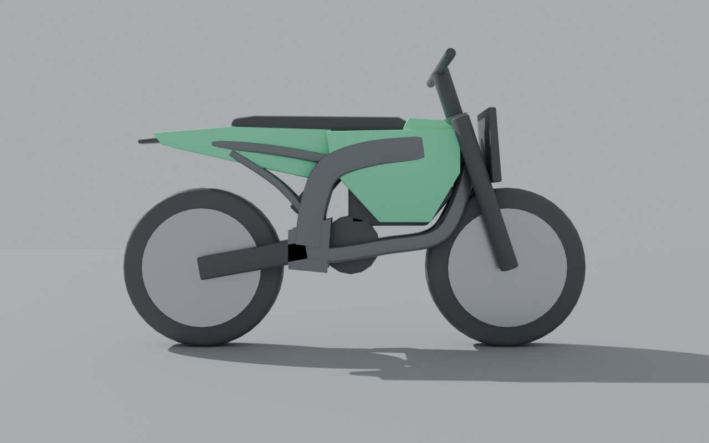

# Surron-style bike body (Blender meshes)

The bike's frame, battery, side plastics, seat and rear mudguard can come from Blender meshes
instead of Roblox parts, which gives the bikes a Surron Light Bee-style shape: box-section
frame, big side covers over the battery, a long flat seat and a pointed tail. Wheels, forks,
bars, swingarm, motor and shock stay as parts because they move and are customised separately.



Until the meshes are imported into Studio the game builds the old part-made bike, so nothing
breaks in the meantime.

## Import into Studio (once)

1. In Studio, open **Avatar → Import 3D** (or **File → Import 3D**).
2. Import these five files from `tools/blender/out/`, one at a time:
   `Frame.obj`, `BatteryCover.obj`, `Plastics.obj`, `Seat.obj`, `Mudguards.obj`.
   The default settings are fine; position and size are fixed up by the game.
3. In the Explorer, make a **Folder** called `BikeMeshes` inside **ReplicatedStorage**.
4. Move the five imported MeshParts into it and make sure they're named exactly
   `Frame`, `BatteryCover`, `Plastics`, `Seat`, `Mudguards`. (It's fine if each sits inside its own
   Model; the game searches the folder.)
5. Delete anything the importer left in Workspace, then **File → Publish to Roblox** so the meshes
   upload with the place. Rojo leaves the folder alone.

All five must be there; if one is missing the game falls back to the part-made bike.

## Changing the shape

Edit `tools/blender/build_bike_body.py` (one function per paint slot), then run it with Blender:

```
blender --background --python tools/blender/build_bike_body.py -- --render
```

or with the `bpy` Python module (`pip install bpy`):
`python3 tools/blender/build_bike_body.py --render`.

It rewrites the OBJ files, `bike_body.blend` (open it in Blender to look around) and the preview
renders, plus `out/BikeMeshLayout.luau`. Copy that file over
`src/ReplicatedStorage/Shared/BikeMeshLayout.luau`, then re-import the changed meshes in Studio
(replace the old ones in `BikeMeshes`, same names).

Coordinates are the bike's own space in studs, as in BikeBuilder: forward is -Z, the chassis
centre is the origin, the ground is at y = -2.95 on the standard geometry. Bikes with a longer
wheelbase or bigger wheels stretch the meshes to fit. All bikes share this body shape; their
paint, decals and options still differ.
